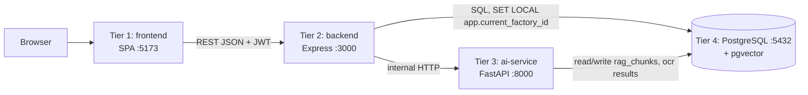

# System Architecture

Status: Specified. Only the data tier (`database/`) is implemented.

## 1. Four tiers

| Tier | Folder | Tech | Port | Responsibility |
|---|---|---|---|---|
| 1 Presentation | `frontend/` | React + Vite (assumed — confirm) | 5173 | UI, forms, charts |
| 2 Business API | `backend/` | Node.js >= 18, Express | 3000 | Auth, RBAC, tenancy, **decision engine**, time feasibility, knapsack planner, PDF dossier, orchestration of AI calls |
| 3 AI service | `ai-service/` | Python, FastAPI | 8000 | OCR, NLP matching, embeddings, RAG; **never produces verdicts** |
| 4 Data | `database/` | PostgreSQL 13+ | 5432 | System of record, RLS, pgvector |

## 2. Service communication
- Browser ↔ Express only. The browser never calls FastAPI or the database.
- Express → FastAPI: internal HTTP with a shared service token header (`X-Service-Token`); FastAPI is not publicly exposed.
- Express and FastAPI → PostgreSQL via `pg` / `psycopg`. Each request runs `SET LOCAL app.current_factory_id = '<uuid>'` inside a transaction (see [MULTI_TENANT_SECURITY.md](../07_security_and_compliance/MULTI_TENANT_SECURITY.md)).
- File storage: uploaded evidence stored outside the DB; `factory_evidence.file_url` holds the reference (storage backend TBD; local disk in dev).

## 3. Design principles
1. **Deterministic core, probabilistic edges.** Verdict path = SQL + pure functions. AI only extracts/suggests/retrieves, with human confirmation.
2. **Append-only history.** `assessment_findings` never updated; each evaluation inserts rows pinned to `rule_version`.
3. **Tenant isolation twice.** App-layer `factory_id` filters + RLS.
4. **Idempotent ops.** Schema and seed scripts are safe to re-run.

## 4. Configuration (environment)

| Variable | Used by | Example |
|---|---|---|
| `DATABASE_URL` | all | `postgres://user:pw@localhost:5432/exportready` |
| `JWT_SECRET` | backend | long random string |
| `AI_SERVICE_URL` | backend | `http://localhost:8000` |
| `SERVICE_TOKEN` | backend, ai-service | random string |
| `LLM_API_KEY` | ai-service | provider key (RAG) |

## 5. Repository layout
See [README](../../README.md). `brain/` is the SSOT and must be updated with code (see [CLAUDE.md](../../CLAUDE.md)).
