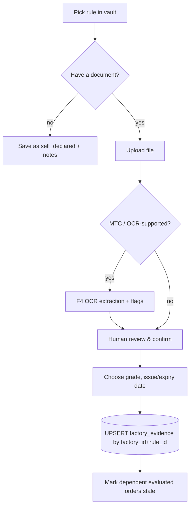

# Evidence Vault Flow (F3 / F4)

Status: Specified. Table `factory_evidence` exists; upload/OCR flows are not implemented.

## Tiers (`proof_grade`)

| Tier | Grade | Meaning | Counts as MET? |
|---|---|---|---|
| 1 | `third_party_verified` | Issued/audited by an independent body (accredited registrar/lab, FDA record, mill 3.1/3.2 MTC) | Yes |
| 2 | `document_backed` | Factory's own controlled records/documents uploaded | Yes, flagged `audit_risk = true` |
| 3 | `self_declared` | Statement only, no supporting file | No (GAP; BLOCKER if the rule is absolute) |
| 4 | `expired` | Past `expiry_date` (stored or derived) | No — always BLOCKER (even for non-absolute rules) |

## Flow

## Rules
1. One current record per (factory, rule) — `uq_factory_evidence_factory_rule`; updates overwrite and bump `updated_at` (history is kept in the audit log once `audit_log` is built).
2. `expiry_date >= issue_date` (DB check).
3. `third_party_verified` requires a file plus an issuer name in `notes` (app-level validation; V2 convention).
4. Expiry is evaluated against each order's **shipment deadline**, not today. A nightly job (or on-read derivation) shows `expired` badges for today's view and powers the Expiry Timeline (F10).
5. Uploading new evidence marks `evaluated` orders of that factory as stale (re-evaluate).
6. Files: stored outside the DB, `file_url` is a reference; type/size validated; per-tenant path prefix.

## Expiry alerts
Dashboard lists evidence expiring within 30/60/90 days using index `idx_factory_evidence_expiry`.
