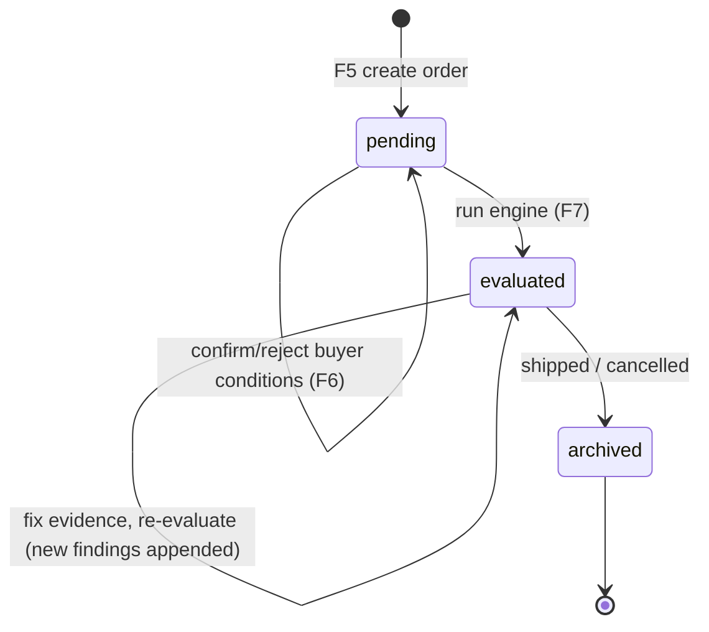

# Order Lifecycle

Status: Specified. `orders.status` ENUM (`pending → evaluated → archived`) exists in the schema.

## Steps
1. **Create (pending).** F5 inserts `orders`; backend inserts baseline `order_rules` (`system_inferred`, `confirmed_by_user=TRUE`) for all active rules applicable to the product (V2: all active rules).
2. **Buyer conditions.** If `buyer_contract_text` is present, F6 proposes `buyer_condition` rows (unconfirmed); user confirms/rejects. Optional — the order can be evaluated without it.
3. **Evaluate.** F7 runs in one transaction: reads applicable rules + evidence, inserts `assessment_findings` (pinned `rule_version`), sets status `evaluated`. F8 feasibility is computed on read.
4. **Remediate loop.** User updates the vault (F3); re-run **Evaluate**. Older findings stay (history); UI shows the latest set and a trend.
5. **Portfolio.** F9 considers all `evaluated` orders (latest findings).
6. **Ship.** Run Gatekeeper (F13) on the invoice; generate dossier (F14).
7. **Archive.** `status = archived` (after shipment or cancellation). Archived orders are excluded from the planner and active dashboard widgets but remain readable and in history.

## Rules
- An order must not be archived as "shipped" through the UI while its latest verdict is BLOCKED without an explicit confirmation dialog (warning, not a hard block — the system is advisory).
- Editing deadline, quantity or contract text of an `evaluated` order marks the evaluation stale in the UI (re-evaluate required).
- Deleting a factory cascades to orders and findings; deleting an order cascades to `order_rules` and findings.
